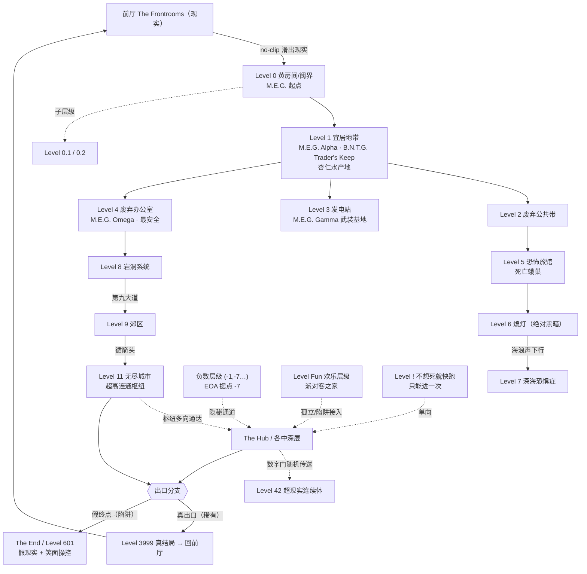

# 后室（The Backrooms）主故事线

> 本文档是整个「后室」知识库的主索引与世界观骨架，综合本目录下的《起源与发展史》《组织总览》《物品总览》《层级总表》、约 80+ 层级档案、25+ 实体档案、8 组织档案与物品档案合成而来。
>
> **一条贯穿全文的铁律**：后室没有单一正典（no single canon）。同一个编号在不同 wiki 上常常是"同号不同设定"。本文档在叙述世界观时，默认以 **Wikidot 新版（backrooms-wiki.wikidot.com，目前最受认可）** 为主轴，辅以 **Fandom 旧版（含中文维基，最大众化）** 与 **Kane Pixels 宇宙（独立影视连续剧设定）**，凡有冲突处一律标注「版本差异」。
>
> **术语约定**：
> - **前厅（The Frontrooms）** = 现实世界。
> - **流浪者（Wanderer）** = 误入后室的人类。
> - **no-clip（滑出现实）** = 误入后室的核心机制，源自电子游戏作弊术语（角色穿过本应阻挡他的碰撞体积）。
> - **Class / 危险等级 0–5**：0 = 安全可居住，5 = 几乎必死之地（部分用 "e" 后缀表示"实体相关"危险，如 Class 2e）。

---

## 第一部分：现实层面时间线（Meta / Out-of-Universe）

后室是一个典型的"**自下而上、去中心化**"的互联网神话：没有原作者、没有官方正典，由一张被剥离语境的照片和一段匿名跟帖意外催生，再经社区协作与影像化滚雪球式膨胀。

| 时间 | 事件 | 意义 |
|------|------|------|
| **2002-06-12** | 原始"黄房间"照片在美国威斯康星州 Oshkosh 市 Oregon 街 807 号一家**正在翻修的家具店**（原 Rohner's Home Furnishings）随手拍摄，文件名 `Dsc00161.jpg` | 这只是张普通照片，与灵异毫无关系 |
| 约 **2003-03** | 照片首次出现在网络（一篇 HobbyTown USA 博客文章） | 进入流通 |
| **2017-05-04** | 作者 Mortos 在 SCP 基金会发布 **SCP-3008（无限宜家 / The Infinite IKEA，Euclid 级）**：无限延伸的宜家口袋维度（SCP-3008-1）+ 夜间凶暴的无脸员工（SCP-3008-2） | 后室"无限日常空间"母题的**概念先驱**，早后室约两年 |
| **2019-05-12** | 后室正式诞生：4chan 超自然板 **/x/** 一帖求"令人不安的图片"，附那张黄房间照；匿名跟帖写下**奠基文本**——"在错误的地方 no-clip 出现实即坠入后室" | **真正起点** |
| **2019-05-16 起** | 经 Reddit（r/greentext 获 32,000+ 赞）、Twitter（@GearboxGunman 动画）迅速扩散 | 出圈第一波 |
| **2019–2021** | 社区从孤立 creepypasta 发展出**层级（Levels）+ 实体（Entities）**体系；借鉴 SCP 协作百科模式（统一编号/模板/投稿/评分）；爆发"纯粹派 vs 扩展派"审美之争 | 世界观系统化 |
| **2022-01-07** | **Kane Pixels（本名 Kane Parsons，时年约 16 岁）** 发布 found-footage 短片《The Backrooms (Found Footage)》（Blender + AE 制作，VHS 质感），被称"互联网最恐怖视频"，累计观看 7000 万至上亿 | 引爆主流；模拟恐怖（analog horror）里程碑 |
| **2022 年内** | Kane 追加发布十余集，扩展至约 24 集，自建独立的 **Async Research Institute（异步研究所）** 与 **1989–1990** 实验/事故时间线 | Kane 宇宙成形（独立设定，不与 wiki 编号互通） |
| **2022–2023** | **Fandom** 与 **Wikidot** 两套维基并立成熟，后室成为"阈限空间"潮流旗帜 | 世界观正式分裂 |
| **2023-02** | A24 宣布开发后室电影，Kane Pixels 执导 | 走向影视产业 |
| **2024-05** | 后室 Discord 社区借 Wayback Machine 破解原始照片真实出处（2002 年家具店） | 谜底揭晓 |
| **2026-05** | 后室电影（A24 / Kane Pixels）上映 | 主流化顶点 |

### 三套互不统属的宇宙

| 宇宙 | 平台 / 载体 | 风格 | 关系 |
|------|-----------|------|------|
| **Fandom** | backrooms.fandom.com（中文维基基于此） | 游戏化、系统化、大众化、入门门槛低 | 与 Wikidot 是平行宇宙 |
| **Wikidot** | backrooms-wiki.wikidot.com | 多 Canon、文学性强、"故事互相渗透/推翻"，仿 SCP | 与 Fandom 是平行宇宙 |
| **Kane Pixels** | YouTube + A24 电影 | found-footage / analog horror，连续剧情 | 与两套维基编号**不互通** |

> **与 SCP 的关系**：后室与 SCP 现为**独立宇宙**，仅同源于 4chan /x/、借用 SCP 协作模式、承接 SCP-3008 母题，**无官方交叉**。"基金会收容后室"一类设定属二次创作。

---

## 第二部分：设定内时间线与世界观架构（In-Universe）

### 2.1 进入机制：no-clip / 滑出现实

后室的世界观奠基于一句话：现实（前厅）拥有像电子游戏一样的"碰撞体积"，而在**错误的地方**，这套碰撞会出现漏洞。当一个人无意间撞穿这层漏洞，他就"滑出"了现实，坠入后室——一片"近乎无限、随机分割的空房间"组成的非欧阈限迷宫。

奠基文本一次性确立了后室的标志意象（"后室三要素"）：
- **陈旧潮湿地毯的恶臭**；
- **单调黄色**带来的疯狂；
- **荧光灯以最大功率嗡嗡作响**的无尽背景噪音；
- 外加"大约六亿平方英里随机分割的空房间"。

进入方式（多为后期扩展）：除经典的 no-clip 外，还有特定层级间的**出入口**、传送门技术、以及某些"Level Key（层级钥匙）"机制。

### 2.2 层级体系：浅层 → 深层 → 负数 → 特殊 → The End

后室的空间被组织为**编号化的"层级（Levels）"**。每个层级是一个独立的、有自己外观与规则的空间。整体并非线性楼梯，而是一张**枝蔓交错的网**：从某层的特定出口可以掉进另一层，连通关系往往**单向、随机、不对称**。

#### A. 核心浅层（Level 0–9）——后室的"门面"

| 层级 | 名称 | 设定要点 | 危险 | 关键出口 |
|------|------|---------|------|---------|
| **Level 0** | 阈界 / 黄房间（Wikidot "Threshold" vs Fandom "The Lobby"） | 单调黄房间走廊，无确认实体，但"孤立效应"使人精神崩溃，死亡率约 85% | Class 1 | → Level 1 |
| **Level 1** | 宜居地带 | 停车场 + 仓库，六区段，闪烁停电时出实体；**M.E.G. Alpha 基地**；盛产杏仁水 | — | 多向 |
| **Level 2** | 废弃公共带 / Pipe Dreams | 欧氏管道隧道；2016–18"大停电"事件 | Class 3 | — |
| **Level 3** | 发电站 | 毒黑黏液 + 自燃机械；**全后室最强 WiFi**；**M.E.G. Gamma 最强武装基地** | Class 4 | — |
| **Level 4** | 废弃办公室 | Class 1 最安全；仅猎犬/钝人；涂黑窗户是陷阱；**M.E.G. Omega 基地** | Class 1 | — |
| **Level 5** | 恐怖旅馆 | 1920–30s 无限酒店，自清洁；死亡飞蛾巢穴 | — | — |
| **Level 6** | 熄灯 | 绝对黑暗 + 寂静，光源失效，无确认实体；听海浪声可下行 | — | → Level 7 |
| **Level 7** | 深海恐惧症 | 无限海洋（四分带），有"延长闭气 30min"的空气；两巨型实体（七层之物 / 小小领地协议） | — | — |
| **Level 8** | 岩洞系统 | 非欧洞穴，熵加速 + 毒气；牧蛇/蛛形实体；"第九大道"通 L9 | — | → Level 9 |
| **Level 9** | 郊区 | 永恒午夜郊区，无电；独特实体（邻里守望/观察者/碾压者）；循箭头可达 L11 | — | → Level 11 |

> 设计逻辑：浅层多为"被剥离语境的日常空间"（大堂、办公室、停车场、旅馆、郊区），恐怖来自**熟悉中的异化**；越往深、越偏离欧氏几何与人类经验。

#### B. 中浅层（Level 10–49）——主题大爆发

随编号增大，层级愈发奇诡，且**同号不同设定**的版本冲突在此段急剧加剧（几乎每个编号在 Wikidot 与 Fandom 上是两套完全不同的创作）。代表：

- **田园/治愈型**：L10 麦田（Class 1）、L11 无尽城市（"11 效应"让实体温和、超高连通枢纽）、L48 日落海滩。
- **致命伪装型**：L13 温水煮青蛙（舒适公寓陷阱，久居 10 年神秘消失）、L14 天堂（最美却 Class 5，"孩子们"同化）。
- **认知/记忆危害**：L12 矩阵（拍照变雪花、记忆迷雾）、L18 回忆（童年场景 + 善意恐龙玩偶）、L19 阁楼地板（地板下橙光篡改记忆）、L30 抽离现实（记忆潜伏者）。
- **极端环境**：L7/L37 水体（崇高·泳池间，Class 0/1，泻盐水，无实体，坚不可摧白瓷砖）、L41 黑湖（95°C 沥青 + 胶原利维坦）、L45 深渊公司（虚空摩天楼 + BRC 总部）、L49 弗列革同河战壕（绝不可反击的 Trenchcleaners 机器）。
- **巨构/科幻**：L15 未来走廊（疑通外太空）、L17 航空母舰（唯一实体 Imprints 对视致脑死）、L36 永恒机场（真航班 + 时间膨胀）、L42 超现实连续体（数字门通随机层级的酒店枢纽）。

#### C. 中深层（Level 50–999）——叙事与梗层级

继续向下，层级承载更复杂的 Canon 叙事与社区"梗"。著名高编号层级：
- **L94 运动（Motion）**：定格动画城镇，白天安全、夜晚地狱。
- **L100 寂静之声**：余光实体 The Shadow。
- **L188 窗户世界（The Windows）**：阈界美学标志（原图为希思罗机场）。
- **L600 空白空间（Blank Space）**：概念性、非地理区域。

#### D. 负数层级（Negative Levels）

负编号层级（如 Level -1、-7 等）通常更原始、更隐秘、更危险，被设定为"现实之下的更深层"。**版本差异**：Fandom 曾一度移除部分负层级，Wikidot 多将其并入"隐秘层级"体系。EOA（阿尔戈斯之眼）的据点 Level -7 即在此列。

#### E. 特殊 / 隐藏层级（非数字编号）

| 层级 | 设定 | 危险 |
|------|------|------|
| **Level !**（感叹号·不想死就快跑，原 Area-847） | 红色医院走廊，进入即触发警报，须不停跑 10 公里逃生，遍布假出口与全后室实体；只能进一次 | Class 5 |
| **Level Fun（欢乐层级）** | 派对客（Entity 67 / 中文站 C-233）之家；**重大版本差异**：经典"=)"生日派对版 vs Fandom 充气城堡 + 血色狂欢病毒版 vs Wikidot 已重编为 Level 26 | — |
| **Level 0.1 / 0.2** | L0 与 L1 之间的子层级：0.1（Class 5，25 万英里走廊，Mrs. Lori 殖民地惨案）；0.2（重塑的混乱，后室翻新公司翻新即崩塌的反讽层） | C5 / C3 |
| **Level ∞（阈限机场）** | 昼夜循环 + 模因污染；登机须如实答题方可逃生 | Class 5 |
| **Level 3999（真结局 / 霓虹街机）** | Class 0 无实体，是**回前室的稀有出口**，带 3999.x/B/C 庞大子层级家族 | Class 0 |
| **Level 9223372036854775807（int64 上限·无限螺旋阶梯）** | 主题"边界由人设定"；跳中央去 Level 94 | — |
| **The End（终焉）** | **双版本**：Fandom 版（Class Beta 空图书馆，"层级间阈限"）vs Wikidot Level 601（"终点"陷阱层，假现实 + 笑面操控） | — |

> 其它重要隐秘层：**枢纽 The Hub**、**蜂巢 The Hive**、**家 Home**、流动商贸市场，以及作为"现实"的 **前厅 The Frontrooms**。

#### F. The End——"出口"的母题

后室的终极悬念是"能否回到前厅"。它有两种相反的呈现：
- **真出口**（如 Level 3999）：稀有、隐秘，但确实通向现实，给绝望以微光。
- **假终点 / 陷阱**（如 Wikidot 的 The End / Level 601）：伪装成"现实"或"图书馆阈限"，实为吞噬希望的最后陷阱——**连"逃出去"本身都可能是幻觉**。

### 2.3 资源经济：杏仁水本位制

后室的生存与社会运转围绕**有限资源**展开，其核心是 **Almond Water（杏仁水，Object 1）**。

| 物品 | 编号(Wikidot) | 定位 | 经济角色 |
|------|--------------|------|---------|
| **Almond Water（杏仁水）** | Object 1 | 金属保温瓶装清澈液体，单瓶约 600 卡，3 瓶满足成人一日所需；具再生/治愈、中和实体效果 | **头号补给品 + 通用货币（硬通货）** |
| **Firesalt（火盐）** | Object 15 | 熔点 47°C，熔为 pyroil 火油 | 对抗 Smiler 等实体的武器/热源/燃料 |
| **Deuclidators（解欧化器）** | Object 4 | 弯曲空间、拉近距离 | B.N.T.G. 量产的高价值商品 |
| **Smiler Repellent（微笑者驱避剂）** | Object 3 | 极稀有 Smiler 克星 | 需与 The Lost 交易获取 |
| **Royal Rations（皇家口粮）** | Object 16 | 极致美味、令人上瘾的白色凝胶 | 高端消费/成瘾品 |
| **The Mirror（镜子）** | Object 6 | Level 0 唯一，映前厅往昔，不可破坏、攻击反伤 | 信仰/精神象征物 |

- **杏仁水的颜色变种**（Wikidot 版）：灰（最常见、营养最高）、绿（咖啡因提神、易成瘾）、红（抗生素、过量致癌）、蓝（助眠抗焦虑、过量永久成瘾）。
- **警告与潜规则**：勿饮半空瓶（可能掺毒）；某些层级的杏仁水带氰化物般毒性，"拿不准就煮沸"；**Liquid Pain（液态痛苦）会伪装成杏仁水**，是经济信任体系里的"假币"威胁。
- **货币化**：B.N.T.G. 在此基础上发行自己的货币 **presses**，把"杏仁水本位"推进到更成熟的金融体系。

### 2.4 组织：兴衰与冲突

后室的"人类社会史"由几大派系的合作与对抗构成。

| 组织 | 全名 / 定位 | 据点 | 立场 / 命运 |
|------|------------|------|------------|
| **M.E.G.** | Major Explorer Group（主要探索者集团） | Level 1/3/4/5 等；Alpha–Epsilon 主基地 | **最大探索/救援/后勤组织**；成立时间版本差异（Wikidot 2012/2014 vs Fandom 中文 1885）；与 Fandom 的 The Insurrection（叛乱组织）交战 |
| **B.N.T.G.** | Backrooms Nonaligned Trade Group（不结盟贸易集团） | Level 1 的 Trader's Keep/Vault | 由 Arthur Mellon 与 Diana Stewards **从 M.E.G. 分裂**创立；格言"以繁荣求和平"；严守中立、发行货币 presses；任务点名的"Negative-One"展开属少数 backronym，主流为 Nonaligned |
| **U.E.C.** | Unbound Explorers Coalition（无垠探索者联盟） | Level 76/466/502 等；831 已毁 | Diana Stewards 创立的军事化组织，与 B.N.T.G. 同源；有"人道口号"与"残酷手段"两面性 |
| **EOA** | The Eyes of Argos（阿尔戈斯之眼） | Level -7、46.1、261 等 | 自封私刑正义，五大巡逻队 + Overseer Team；创始人 Argos 生死有版本差异；子分队 Sons of Guilt |
| **The Lost** | 迷失者 | Level 1/2/3/5 | 远古文明部族联盟（Lost Suns / Lost Legion）；与 The Pantheon（万神殿）、Iron Fist 绑定 |
| **Iron Fist** | 铁拳 | 隐秘流动，随 Pantheon 目标转移 | 远古**弑神**武装教团 |
| **F.O.J.** | Followers of Jerry（杰瑞信徒） | Level 2 "Holy Purple"、Level 3 "Blue Salvation" | 崇拜蓝鹦鹉实体 Jerry 的末日邪教 |
| **Party Crashers** | 派对终结者（旧称 Anti-Jovials） | 机动巡逻，无固定总部 | 反 SFV（欢乐病毒）军事民兵；与 Level Fun / 派对客对立 |

**主线冲突轴**：
1. **探索 vs 贸易 vs 军事**：M.E.G.（探索救援）→ 内部分裂出 B.N.T.G.（中立贸易）与 U.E.C.（军事），三者同源却路线相异。
2. **秩序 vs 私刑**：M.E.G. 的探索伦理 vs EOA 的自封正义。
3. **古神信仰 vs 弑神**：The Lost / Pantheon（崇拜古神）vs Iron Fist（弑神教团）。
4. **理性求生 vs 邪教/病毒**：各组织 vs F.O.J.（杰瑞邪教）、Party Crashers vs SFV 病毒。

> **重要考据**：任务点名的 **"Crimson Brigade（绯红旅）"** 与 **"The Game Masters"** 在主流后室 wiki **均无对应组织条目**——"Crimson"仅为地点（绯红森林），"Game Master"是 Entity 99（实体）而非团体。本节据实标注，未编造。

### 2.5 实体威胁的分布

实体（Entities）是栖居各层级的敌对/中立生物，威胁形态与层级深度大致相关。

| 实体 | 编号 | 威胁形态 | 主要分布 | 应对 |
|------|------|---------|---------|------|
| **Smiler（微笑者）** | Entity 3 | 黑暗中浮现的发光眼牙 | 任何有黑暗的层级 | 眼神对峙；经典版趋光、新版惧光火（黑焰/炽笑） |
| **Hound（猎犬）** | Entity 8 | 四足嗜血、极速 | 卵源 Level 276，几不上 Level 12 | 远距处理 |
| **Skin-Stealer（剥皮者）** | Entity 10 | 穿人皮拟态、窃取身份 | Level 1–3 | 验血——"血红尚生，血清莫近" |
| **Facelings（无面人）** | Entity 9 | 无五官类人 | 广布 | 温顺但孩童凶；有暗影/记忆/进化变体 |
| **Windows（窗户）** | Entity 2 | 伪装窗户诱拐 | Level 4 黑窗为陷阱 | 新版为捕食性思维空间 |
| **Deathmoth（死亡蛾）** | Entity 4 | 蜂群三阶级（普通/禁卫/蛾后），威胁 EXTREME | Level 5 巢穴 | S.W.A.R.M.S. 准则；雄性可用杏仁水驯化 |
| **Clumps（聚合体）** | Entity 5 | 人肢扭结伏击、残血再生 | 多层 | Oni 面具可慑 |
| **Wretches（可怜虫）/ Insanities（疯子）** | Entity 15 | 人因缺食/水/眠经"Wretched Cycle"丧尸化、黏液传染 | 广布 | 杏仁水仅救早期；版本差异：Wikidot 现名 Wretches |
| **Partygoer（派对客）** | Entity 67 / C-233 | 黄皮笑脸 + 带牙吸盘臂，可瞬间将人转化为同类、群猎 | Level Fun | 砍臂攻头逃跑；版本差异：游戏版"友善" vs Wikidot 嗜虐 |
| **Bacteria（细菌 / The Lifeform）** | — (Kane) | 约 3.35m 黑线缆人形，对声/光高度敏感 | Kane 宇宙 | 须潜行 |
| **Dullers（钝化者）** | Entity 6 | 灰黑无脸长臂，noclip 穿墙拖人 | 多层 | 怕杏仁水，被正面冲会逃 |
| **Crawlers（爬行者）** | Entity 17 | 异常真菌瘟疫，仅液体传染、12 分钟 5 阶段 | 多层 | 无解药，须远距枪杀 |
| **Death Rats（死亡鼠）** | Entity 24 | 演化型啮齿，食死亡蛾与霉菌 | 多层 | 多无害，勿激怒 |
| **Mimic（拟态体）** | Entity 400 | 拟态房间诱捕 | 多层 | 警惕异常房间 |

**威胁分布规律**：
- **浅层（0–4）** 以拟态/欺骗类为主（Skin-Stealer 窃身份、Windows 诱拐、Mimic 假房间）——恐怖来自"分不清真假"。
- **中层** 以群体/瘟疫类为主（Deathmoth 蜂群、Wretches/Crawlers 传染、Partygoer 群猎）——恐怖来自"被同化/被吞没"。
- **黑暗层级** 以 Smiler 为标志——恐怖来自"看不见的注视"。
- 注：**Hungry Homes（饥饿之家）** 经核查在主流 wiki 不存在，据实标注，最贴近的真实实体为 Mimic / Predatory Doors（Entity 63）。

---

## 第三部分：「层级—实体—组织」连接图

### 3.1 层级连通拓扑（mermaid）

> 说明：实线 = 较稳定/常见出入口；虚线 = 隐秘/随机/单向通道。后室连通本质是**网状、不对称**的——从 A 能到 B 不代表能从 B 回 A。

### 3.2 三元关系矩阵（层级 × 实体 × 组织）

| 层级 | 主要实体威胁 | 驻扎/活动组织 | 关键资源/物品 |
|------|------------|-------------|--------------|
| Level 0 黄房间 | （无确认；孤立效应） | M.E.G. 起点 | The Mirror（唯一） |
| Level 1 宜居地带 | Skin-Stealer | **M.E.G. Alpha**、**B.N.T.G.**（Trader's Keep）、The Lost | **杏仁水**、presses 货币 |
| Level 2 废弃公共带 | Skin-Stealer | The Lost、F.O.J.（Holy Purple） | 火盐、Babel Balm |
| Level 3 发电站 | （黑黏液/自燃机械） | **M.E.G. Gamma**（最强武装）、F.O.J.（Blue Salvation） | 最强 WiFi、火盐 |
| Level 4 废弃办公室 | Hound、Dullers、Windows（黑窗陷阱） | **M.E.G. Omega** | Babel Balm |
| Level 5 恐怖旅馆 | **Deathmoth（蜂群）** | M.E.G.、The Lost | Deuclidators 初见 |
| Level 7 深海恐惧症 | 七层之物 / 小小领地协议 | — | 延时空气 |
| Level Fun | **Partygoer（派对客 E67）** | Party Crashers（对抗） | — |
| Level -7 | （负层级实体） | **EOA**（阿尔戈斯之眼） | Smiler Repellent（经 The Lost） |
| Level 46 沙漠 | 沙之灵 | M.E.G.、EOA(46.1) | **Liquid Pain**（伪装杏仁水）|
| Level 276 | **Hound（卵源）** | — | — |
| Level 3999 真结局 | （无实体） | — | **回前厅出口** |

---

## 第四部分：核心母题与恐怖来源分析

后室之所以成为现象级恐怖，不在血腥与 jump-scare，而在它精准击中了几个**结构性的人类恐惧**。其恐怖是"慢性的、环境的、存在主义的"。

### 4.1 阈限空间（Liminal Space）——熟悉中的异化

这是后室美学的**第一内核**。阈限空间指那些"过渡性的、本应有人却空无一人的"场所：空荡的走廊、深夜的办公室、停业的商场、无人的停车场。

- **机制**："熟悉之物因失去语境而变得恐怖。"原始黄房间照片本是普通家具店翻修照，一旦被剥离上下文（没人、没目的、没时间标记），大脑就会拉响"这里不对劲"的本能警报。
- **体现**：Level 0（黄房间）、L4（办公室）、L37（泳池间）、L188（窗户世界，原图希思罗机场）——全是"你一眼认得、却绝不该独自身处其中"的地方。
- **恐怖来源**：不是"有怪物"，而是"**这里本该有人，为什么只有我？**"

### 4.2 孤独与隔绝（Isolation）

- **机制**：no-clip 是**单人**坠落；后室的死亡率（如 L0 的 85%）大多来自"孤立效应"——精神在无尽空旷与单调中崩溃，而非被实体杀死。
- **体现**：Level 6（绝对黑暗 + 绝对寂静）把孤独推到极致——你甚至失去了"看见"和"听见"自己的能力。
- **社会学回响**：正因孤独致命，被困者才本能地结成 M.E.G. 这样的社群——**整部"组织史"本质是人类对抗孤独的求生史**。

### 4.3 无限（The Infinite）——空间与希望的双重耗竭

- **机制**："约六亿平方英里随机分割的空房间"——空间是**无限且无意义**的。没有地图能完成，没有方向是"对的"，走多久都到不了尽头。
- **递归恐怖**：层级体系本身就是无限的嵌套——Level 9223372036854775807（int64 上限）正是对"无限到底有多大"的戏谑式逼问；而 **The End** 把无限的终点写成**陷阱**：连"出口"都可能是无限的一部分。
- **恐怖来源**：不是怕死，而是怕"**永远走不出去、永远没有结束**"——希望本身被无限稀释。

### 4.4 异化与身份消解（Dehumanization）

- **机制**：后室不仅吞噬身体，更吞噬"自我"。
- **体现**：
  - **Skin-Stealer**：偷走你的皮囊与身份——"被取代"。
  - **Wretches/Insanities**：缺食缺水缺眠就丧尸化——"人沦为非人"。
  - **Partygoer**：一触即被同化为同类——"被融入群体而失去个体"。
  - **Level 13 / Level Fun**：用舒适与欢乐温柔地消解你的警觉与自我，直到你"神秘消失"。
- **恐怖来源**："**我还会是我吗？**"——身份与人性的不可保全。

### 4.5 综合：后室恐怖的本质公式

> **后室 = 熟悉的场所（liminal）× 无限的空间 × 彻底的孤独 × 身份的不可保全。**

它把恐怖从"外部威胁（怪物）"转向"**存在状态本身**"——困在一个看似无害、实则永无尽头、且会慢慢抹去你之所以为你的世界里。这正是它超越传统怪谈、成为"互联网时代存在主义恐怖"代表作的原因。

---

## 附录：本知识库导航

| 模块 | 路径 | 说明 |
|------|------|------|
| 起源与发展史 | `00-起源与发展史.md` | 现实层面时间线详版 |
| 与 SCP 的关系 | `00-渊源-与SCP的关系.md` | 独立宇宙考据 |
| 层级全量索引 | `层级/00-层级总表.md` | Level 0–999 + 负层级 + 隐秘层 |
| 层级详细档案 | `层级/Level-*.md` | 约 80+ 层级单篇 |
| 实体档案 | `实体/*.md` | 25+ 实体单篇 |
| 组织档案 | `组织/*.md` + `组织/00-组织总览.md` | 8 组织 + 总览 + 绯红旅考据 |
| 物品档案 | `物品/*.md` + `物品/00-物品总览.md` | 杏仁水等核心资源 |

> **使用提醒**：引用任何设定前，务必先确认出处是 **Fandom / Wikidot / Kane Pixels / 某语言分部**——后室无单一正典，版本差异是常态而非例外。
